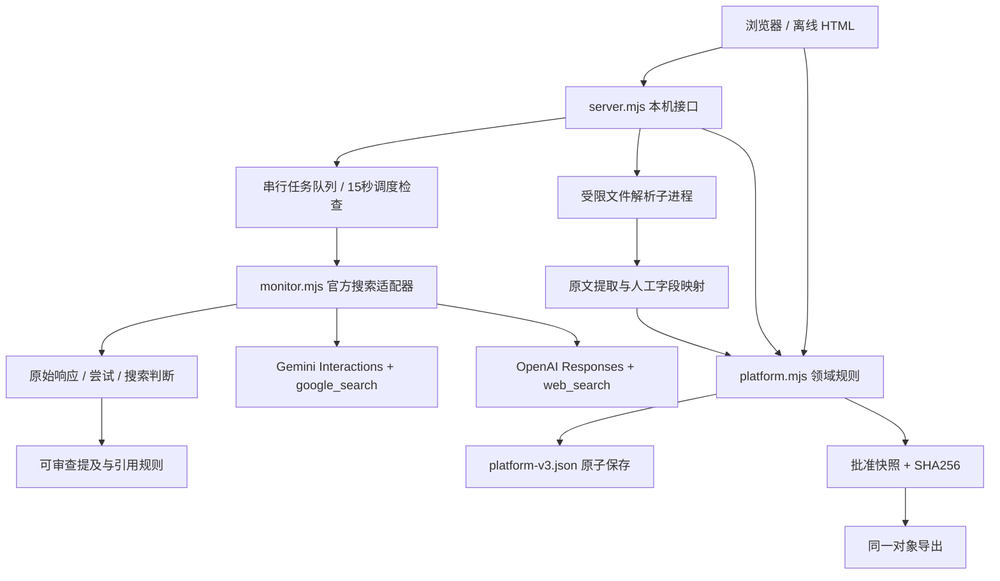

# 架构与数据流

## 当前实现

浏览器视图 → 领域操作 → 本机 HTTP 服务 → 串行事务队列 → 原子 JSON 状态文件。官方搜索适配器独立于内容生成；文件解析作为有限时长的 Python 子进程。前端由同一份源码编译为一个 bundle，HTTP 和离线 HTML 共用，避免复制业务核心。

`src/platform.mjs` 包含状态机、来源/事实/问题/计划/诊断/内容/实验；`src/hash.mjs` 提供规范 JSON 与便携 SHA256；`src/ui.mjs` 负责视图和操作；`monitor.mjs` 负责官方协议、重试、预算和持久化检查点；`server.mjs` 负责 HTTP 边界和串行写入；`scripts/extract.py` 只提取上传文件。

## 主要实体

| 实体 | 关键关联与约束 |
| --- | --- |
| workspace | 品牌别名、域名、竞品、数据声明；不等于完成企业身份验证 |
| product/source/fact | 事实绑定唯一 productId；原文、出处定位、来源校验值、单位、条件和审核状态 |
| prompt/plan | 问题保存版本；plan.config 深拷贝完整问题集、企业配置、模型和采样条件，并计算 configHash |
| run/attempt | run 按计划/版本/周期/问题版本形成幂等 ID；attempt 分开记录每次尝试；每个问题样本只归属其商品 |
| diagnosis | 关联 run 与当前有效事实，诊断性质保留为 hypothesis |
| revision | 片段、决定、人工编辑与版本；approved 保存 artifact、hash、时间；拒绝片段保留在审核记录中，使用时只采用 decision=accept 的片段 |
| experiment | 批准内容哈希、冻结采样配置、基线 ID、用户声明上线时间；只比较真实有效记录 |

## 接口

GET `/api/state`、`/api/health`、`/api/metrics`、`/api/retrieve`、`/api/export`、`/api/experiment`。

POST `/api/workspace`、`/api/import`、`/api/fact`、`/api/withdraw`、`/api/prompts`、`/api/prompt`、`/api/plan`、`/api/plan-action`、`/api/execute`、`/api/diagnose`、`/api/content`、`/api/edit-content`、`/api/approve-content`、`/api/rollback`、`/api/experiment`、`/api/extract`。这是本地 MVP 接口，不是生产 `/v1` 多租户协议。

普通写入携带 stateRevision；内容审批同时携带 expectedRevision，冲突返回 409。领域校验失败不提交克隆状态。外部执行串行化，每次请求开始和结束均保存检查点；异常重启后的进行中记录标记结果未知，不自动重试可能已计费的调用。预算按计划、UTC 天计数，每次尝试预留金额，包括失败请求。达到上限暂停计划；批次内至少三条失败时暂停。没有持久化分布式队列或跨进程锁，不允许两个服务共用一个状态文件。

## 安全边界与生产演进

仅绑定 127.0.0.1，检查 Host 与写入 Origin，JSON 请求 8 MB 上限，静态文件限定 dist，文档下载使用白名单。密钥只从后端环境读取，不进入浏览器状态；错误响应不记录供应商原文，成功原始数据对已配置密钥做字面脱敏。该脱敏不是通用敏感信息检测。

文件扩展名白名单、体积与展开大小限制、禁宏、解析超时；PDF/DOCX 结果必须人工映射参数。未实现互联网 URL 抓取，因此没有伪装已完成 SSRF/robots 抓取策略。网页对所有插入的文本进行 HTML 转义，来源链接只可导航 http/https。

当前是本机单用户，不具备身份认证、多租户权限、加密存储、日志保留策略或云端 SLA。生产演进依次是 PostgreSQL 行级租户隔离、服务端认证/RBAC、持久队列和常驻调度、文件隔离解析、可配置供应商计价与对账、向量索引和检索评测、人工标注台、CMS/CRM 授权接入。密钥配置不等于上述生产保障已完成。

离线 HTML 的 approved hash 用于检测意外篡改，不是身份签名；本地文件编辑者有能力改写状态。生产审批需要服务端审计和操作者身份。
