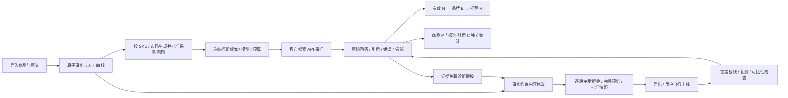

# GEO SIGNAL 产品需求与实现范围

版本 3.0 · 2026-10-16。依据《GEO 智能监测与优化平台 PRD v1.0》重构为商品级 GEO 运营系统。以下区分当前本地 MVP 和后续生产建设，不将方案视为已经交付的能力。

## 用户与目标

企业运营负责人检查品牌是否在 AI 采购回答中出现；外贸营销人员组织问题、执行监测并修改内容；商品运营人员核验事实、处理参数冲突。当前单用户本机版本不模拟注册、权限分级或管理员跨租户访问。

核心问题是：哪些商品在什么采购语境下出现、证据是什么、可核验的内容还能如何改、修改后表现是否变化。平台不能保证第三方收录、排名、推荐或询盘转化。

## 产品闭环

## 需求对照与优先级

| PRD 功能 | 当前可运行实现 | 未完成 / 后续验收 |
| --- | --- | --- |
| F01 商品与事实库 P0 | CSV/JSON、XLSX 行映射；DOCX/PDF 原文提取；SKU 隔离、属性/单位/条件、出处定位、校验值、事实审核、冲突裁定、相同内容去重、来源撤回、关键词检索 | URL 抓取、OCR、自动文档事实抽取、向量混合检索、实体元数据编辑、证书过期检查 |
| F02 监测计划 P0 | 多 SKU、市场/语言、Gemini/OpenAI、1/4/24 小时、冻结配置、暂停/恢复/克隆、按计划每日尝试和预算预留限制、串行队列、批次失败暂停 | 按系列/类目快捷选择、计划就地改版、可调并发、跨机器常驻调度 |
| F03 采购问题 P0 | 类目模板生成 en/de/zh 候选；来源、意图、规则优先级、编辑版本、逐条批准；计划锁定问题快照 | LLM 挖掘、授权搜索日志整合、语义聚类、模板中类目翻译、模型分类评测 |
| F04 联网采样 P0 | 官方 REST 适配、请求摘要、原始响应、引用偏移、实际搜索判断、错误记录、429/5xx 有界重试、幂等、进程中断保护 | 真实账户在线联调（待本机配置）、Perplexity 当前 Agent API、消费者端测试 |
| F05 指标与证据 P0 | N/B/R 漏斗、独立 P/C、品牌/商品/引用证据、来源隔离、SKU/平台/国家/语言/意图/日期筛选、按日表、竞品提及、预算与尝试 | 趋势折线图、批量人工标注纠错、规则识别质量的独立多语言样本评测 |
| F06 诊断 P0 | 原始 run + 已审核事实、观察对应的待验证假设、影响/意图/置信度/工作量/风险评分 | 竞品网页核实、技术可达性扫描、LLM 多样化诊断、确认技术问题类别 |
| F07 内容工作台 P0 | 参数/FAQ 两类片段，前后对比、接受/拒绝/人工编辑、缺材料任务、完整审批预览、SHA256 冻结快照、原样导出、回退新草稿 | 标题/选型指南等更多片段、人工新声明自动核验、CMS 发布与回滚 |
| F08 复测 P0 | 真实基线锁定、内容哈希和用户声明上线时间、后续样本比较、模型/问题/采样配置不匹配阻止、小样本提示、近似区间 | 在线数据验收、对照组、配对分析、季节性控制和因果设计 |
| F09 业务归因 P1 | 未接入 | 站点分析、CRM、询盘与商机归因，区分直接观察和推测影响 |

P0A 本地闭环已实现；P0B 需要完成 API 在线验收、更多真实资料和样本质量评估。P1 建设多租户、云调度与授权归因；P2 才扩展更多平台和高级实验。完整生产版 PRD 尚未全部完成。

## 指标与验收

N 为去重后成功、非空且确认执行搜索的回答；B 为品牌提及；R 为明确针对我方品牌的推荐，必须属于 B；P 为商品名称或型号提及；C 为我方域名引用。B/N、R/B、R/N 是不同口径；C/N 与 P/N 不强制经过 B。

案例验收固定 N=100、B=32、R=18、C=12，R/B=56.25%；12 条引用样本刻意不提及品牌，用于防止误把引用塞进漏斗。所有案例样本均为 synthetic。

请求重试增加 attempts，不增加成功样本 N。预算预留每次尝试递增；供应商实际计费未知时为 null，不把 token usage 当作账单。UTC 日期作为每日限额边界，界面原始时间为 ISO UTC。

监测提示词不附加企业 RAG。当前只接受不预先提示我方品牌的发现类问题，品牌词问题另建口径后再支持。内容修改引用可用事实；人工新写的声明必须由审核人核实，模板约束不构成对自由编辑的自动真实性保证。

批准前必须处理每个片段、查看完整产物并确认声明；批准后不可编辑。导出对象就是批准快照，目录变化不触发重渲染。来源撤回阻止新检索和新审批，历史批准证据仍保留原快照。

复测只显示观察变化，不把前后差异解释为因果。问题、模型、商品和采样配置变化时不比较；任一阶段 N<30 时优先提示样本不足。近似区间不是小样本统计保证。
